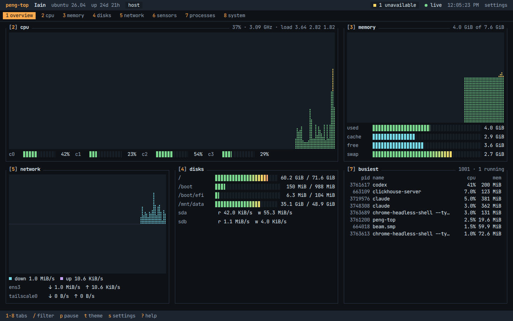

<h1 align="center">peng-top</h1>
<p align="center">
<i>A system monitor for your browser, in one small binary</i>
<br />
<b>📦 <a href="https://github.com/NotAFlightRisk/peng-top/releases/latest">Latest release</a></b><br />
</p>

<p align="center">

</p>

<details>
  <summary>Contents</summary>

- [Install](#install)
  - [Linux and macOS](#linux-and-macos)
  - [Windows](#windows)
  - [Docker](#docker)
  - [From a release, by hand](#from-a-release-by-hand)
  - [Building from source](#building-from-source)
- [Usage](#usage)
- [Configuration](#configuration)
- [Running it as a service](#running-it-as-a-service)
- [Troubleshooting](#troubleshooting)

</details>

## Install

### Linux and macOS

```bash
curl -fsSL https://raw.githubusercontent.com/NotAFlightRisk/peng-top/main/scripts/install.sh | sh
```

That grabs the latest release for your OS and CPU, checks it against the release's checksums and drops `peng-top` into `/usr/local/bin` (or `~/.local/bin` if that's not writable). Set `PENGTOP_INSTALL_DIR` to put it somewhere else.

### Windows

In PowerShell:

```powershell
irm https://raw.githubusercontent.com/NotAFlightRisk/peng-top/main/scripts/install.ps1 | iex
```

It installs to `%LOCALAPPDATA%\peng-top` and adds that to your user `PATH`, so open a fresh terminal afterwards.

### Docker

```bash
docker run -d --name peng-top --pid host --network host -v /:/host:ro,rslave ghcr.io/notaflightrisk/peng-top
```

Then open [localhost:7340](http://localhost:7340). Those three flags are what let it see the host rather than its own container: `--pid host` for the processes, `--network host` for the network, and the read-only `/` mount for disks, sensors and the rest. Drop them and it still runs, it just shows the container (and says so in the top bar).

Prefer Compose? There's a ready-made [`docker/compose.yaml`](../docker/compose.yaml):

```bash
curl -fsSLO https://raw.githubusercontent.com/NotAFlightRisk/peng-top/main/docker/compose.yaml
docker compose up -d
```

The image is also on DockerHub as [`notaflightrisk/peng-top`](https://hub.docker.com/r/notaflightrisk/peng-top), for `amd64`, `arm64` and `arm/v7`. On Docker Desktop (macOS and Windows) the "host" is Docker's own VM, so you'll want the binary there instead.

### From a release, by hand

Every [release](https://github.com/NotAFlightRisk/peng-top/releases) has an archive per platform, plus `checksums.txt`, a [Sigstore](https://www.sigstore.dev/) signature for it and an SBOM per archive. Download the one for your machine, unpack it and run `peng-top`. To check it's ours:

```bash
sha256sum --ignore-missing -c checksums.txt
cosign verify-blob checksums.txt \
  --bundle checksums.txt.sigstore.json \
  --certificate-identity-regexp '^https://github.com/NotAFlightRisk/peng-top/' \
  --certificate-oidc-issuer https://token.actions.githubusercontent.com
```

### Building from source

You'll need [Go](https://go.dev/dl/) 1.26+ and [Node](https://nodejs.org/) 22+.

```bash
git clone https://github.com/NotAFlightRisk/peng-top.git
cd peng-top
make build
./peng-top
```

`make build` builds the web UI and bakes it into a single `./peng-top`. For working on it, `make dev` runs the server and `npm --prefix web run dev` runs the UI with hot reload (it proxies `/api` through to the server). `make test` and `make lint` do what you'd expect.

---

## Usage

Run `peng-top` and open the link it prints, [localhost:7340](http://localhost:7340) by default. `Ctrl+C` stops it.

Everything's driven from the keyboard if you like: `1`-`8` jump between tabs, `/` filters processes, `p` pauses, `t` cycles themes and `?` shows the rest. Settings (theme, units, what's on the overview and so on) are behind `s`, and they're saved in your browser.

The raw numbers are there too, if you'd rather script it:

```bash
curl -s localhost:7340/api/snapshot   # latest reading, as JSON
curl -s localhost:7340/api/info       # the machine, plus anything it couldn't read
curl -sN localhost:7340/api/stream    # server-sent events, one reading per tick
```

---

## Configuration

Every option is a flag, or an env var with the same name in capitals and a `PENGTOP_` prefix. Flags win.

| Flag | Env var | Default | What it does |
| --- | --- | --- | --- |
| `--host` | `PENGTOP_HOST` | `127.0.0.1` | Address to listen on. `0.0.0.0` to open it up to your network |
| `--port` | `PENGTOP_PORT` | `7340` | Port to listen on |
| `--interval` | `PENGTOP_INTERVAL` | `2s` | How often to take a reading, `500ms` at the quickest |
| `--history` | `PENGTOP_HISTORY` | `150` | How many readings the graphs start with when you open the page |
| `--auth` | `PENGTOP_AUTH` | | Ask for a login, as `user:password` |
| `--allowed-hosts` | `PENGTOP_ALLOWED_HOSTS` | | Extra hostnames it'll answer to, comma separated, or `*` for any |
| `--host-root` | `PENGTOP_HOST_ROOT` | | Where the host's `/` is mounted, in a container. The image sets `/host` |
| `--log-level` | `PENGTOP_LOG_LEVEL` | `info` | `debug`, `info`, `warn` or `error` |
| `--no-color` | `PENGTOP_NO_COLOR` | | Plain logs. `NO_COLOR` works too |
| `--open` | `PENGTOP_OPEN` | | Open it in your browser once it's up |

`peng-top --help` lists them, `--version` prints the version, and `--healthcheck` checks a running copy answers (that's what the Docker image's health check uses).

Anyone who can reach it can see your process list, command lines included, so think before putting it on `0.0.0.0` without `--auth`. Out of the box it only answers to `localhost`, IP addresses and your machine's own name, which stops a dodgy website reaching it through your browser. If you put it behind a reverse proxy or a hostname like `nas.lan`, add that with `--allowed-hosts` (setting `--auth` turns the check off, since a login does the same job).

---

## Running it as a service

On Linux with systemd, save this as `~/.config/systemd/user/peng-top.service`:

```ini
[Unit]
Description=peng-top

[Service]
ExecStart=%h/.local/bin/peng-top
Restart=on-failure

[Install]
WantedBy=default.target
```

Then `systemctl --user enable --now peng-top`, plus `sudo loginctl enable-linger $USER` if you want it running while you're logged out. Swap the `ExecStart` path for `/usr/local/bin/peng-top` if that's where it went. On a box that mounts `/proc` with `hidepid`, it'll only see your own processes unless it runs as root.

On macOS and Windows, Docker or a login item is the easy route.

---

## Troubleshooting

**"no temperature sensors here"** is normal in VMs and a lot of cloud boxes, there just aren't any. The System tab lists everything it couldn't read and why.

**"peng-top doesn't know ..."** means you've reached it by a hostname it doesn't recognise, see `--allowed-hosts` above.

**The top bar says "container"** when you wanted the host: you're missing `--pid host`, `--network host` or the `/:/host` mount.

**Something else?** Run it with `--log-level debug` and [open an issue](https://github.com/NotAFlightRisk/peng-top/issues/new?template=bug_report.yml) with what it prints.

---

<p  align="center">
  <a href="https://github.com/NotAFlightRisk"></a><br>
  <sup>
    <i>Licensed under <a href="../LICENSE">MIT</a>, © <a href="https://peng.ly">NotAFlightRisk</a> 2026</i>
  </sup>
</p>

<!--
oooh, hello there! hope you're having a nice day :)
   |\__      |\___
 (:> __)X  (:o ___(
   |/        |/
-->
